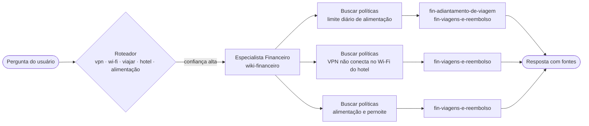

# Nota de arquitetura · Encontro 4

**Equipe:**
**Integrantes:**

> Uma página. A pergunta é uma só: **a divisão em vários agentes se paga no caso da Aurora?** Decidir **não** dividir, com números, é uma resposta tão válida quanto dividir.

## 1. O padrão escolhido

<!-- Nomeie o padrão: agente único com ferramentas, roteador + especialistas, ou supervisor + especialistas.
     Diga a configuração: roteador (llm ou regra), equipe (3 ou 4), handoff, o que fazer quando o roteador está incerto. -->

**Padrão:** Roteador + Especialistas

**Configuração:** roteador regra · 4 esp · original · incerto→segue

## 2. O diagrama

<!-- Ajuste o diagrama ao padrão escolhido. O GitHub desenha blocos mermaid sozinho.
     Mostre quem chama quem e que espaços da wiki cada agente enxerga. -->



## 3. O placar

<!-- Cole aqui a tabela que o Passo 4 do notebook 02 imprime. Precisa ter a linha de base (agente único)
     e pelo menos duas configurações. -->

| arquitetura | acertos | rota certa | chamadas/caso | tokens/caso | custo total (US$) | custo/acerto (US$) | seg/caso |
|---|---|---|---|---|---|---|---|
| agente único (Aula 3) | 16/19 | 17/17 | 2.6 | 3007 | 0.0655 | 0.00409 | 2.7 |
| roteador llm · 3 esp · original · incerto→segue | 16/19 | 14/17 | 3.1 | 2588 | 0.0599 | 0.00375 | 3.2 |
| roteador regra · 3 esp · original · incerto→segue | 16/19 | 14/17 | 2.0 | 2279 | 0.0506 | 0.00316 | 2.1 |
| roteador llm · 4 esp · original · incerto→segue | 16/19 | 14/17 | 3.1 | 2576 | 0.06 | 0.00375 | 3.3 |
| roteador llm · 3 esp · resumo · incerto→segue | 16/19 | 14/17 | 3.1 | 2581 | 0.0598 | 0.00374 | 3.1 |
| roteador llm · 3 esp · original · incerto→único | 15/19 | 14/17 | 3.5 | 3298 | 0.0741 | 0.00494 | 3.5 |
| roteador llm · 3 esp · resumo · incerto→único | 15/19 | 14/17 | 3.5 | 3291 | 0.074 | 0.00493 | 3.4 |
| roteador llm · 4 esp · original · incerto→único | 15/19 | 14/17 | 3.5 | 3295 | 0.0743 | 0.00495 | 3.5 |
| roteador llm · 4 esp · resumo · incerto→segue | 16/19 | 14/17 | 3.5 | 3230 | 0.0729 | 0.00455 | 3.5 |
| roteador llm · 4 esp · resumo · incerto→único | 15/19 | 14/17 | 3.8 | 3947 | 0.0869 | 0.00579 | 3.7 |
| roteador regra · 3 esp · original · incerto→único | 15/19 | 16/17 | 2.6 | 3081 | 0.0669 | 0.00446 | 2.6 |
| roteador regra · 4 esp · original · incerto→segue | 17/19 | 15/17 | 1.7 | 1360 | 0.0326 | 0.00192 | 1.9 |
| roteador regra · 4 esp · original · incerto→único | 15/19 | 16/17 | 2.6 | 3059 | 0.0667 | 0.00444 | 2.7 |
| supervisor · 4 esp | 16/19 | 14/17 | 4.4 | 4218 | 0.0957 | 0.00598 | 4.7 |

Configuração defendida: roteador regra · 4 esp · original · incerto→segue
{'arquitetura': 'roteador + especialistas', 'roteador': 'regra', 'equipe': 4, 'handoff': 'pergunta_original', 'se_incerto': 'seguir'}

## 4. A divisão se paga?

Sim, a divisão em múltiplos especialistas se paga para o cenário da Aurora Tecnologia. Ao adotarmos a arquitetura de roteamento por regras com 4 especialistas específicos, conseguimos elevar a taxa de acertos para 17/19 (superando os 16/19 do agente único) e, ao mesmo tempo, reduzimos o custo por resposta correta em 53% (de US$ 0.00409 para US$ 0.00192), além de diminuir o tempo de resposta do colaborador de 2.7s para 1.9s. Essa estratégia garante o cumprimento da exigência de barreira de acesso à informação (segurança por fonte), uma vez que cada especialista só interage e lê sua própria wiki setorizada. Caso as perguntas dos usuários passem a exigir respostas integradas cross-domain com maior frequência (como no caso R1), voltaríamos ao Agente Único ou adotaríamos um orquestrador de maior custo.
<!-- Três a cinco frases. Respondam com números do placar:
     - O acerto subiu, caiu ou ficou igual em relação ao agente único? E o custo por acerto?
     - O limite entre os especialistas é real (fonte, permissão, ferramenta próprias) ou é só um prompt diferente?
     - Que exigência do caso a divisão atende, ou deixa de atender (controle de acesso por fonte, auditabilidade)? -->

## 5. Um caso, aberto

<!-- O caso do Passo 3 do notebook 02. -->

**Caso:** R1
**Causa:** pergunta de duas áreas
**A linha do trace que mostra a causa:**

```
R1 · Vou viajar a trabalho para o Rio, com pernoite. Qual o meu limite diário de alimentação? E se a VPN não conectar no Wi-Fi do hotel, o que eu faço?
arquitetura: roteador regra · 4 esp · original · incerto→segue

  [roteador] regra: palavras: vpn, wi-fi, viajar, hotel, alimentacao
  [roteador] → financeiro (confiança alta)  · palavras: ['vpn', 'wi-fi', 'viajar', 'hotel', 'alimentacao']
  [roteador] passa adiante → especialista financeiro: “Vou viajar a trabalho para o Rio, com pernoite. Qual o meu limite diário de alimentação? E se a VPN não conectar no Wi-Fi do hotel, o que eu faço?”
      [especialista financeiro] acessa: wiki-financeiro
      [especialista financeiro] recebeu: Vou viajar a trabalho para o Rio, com pernoite. Qual o meu limite diário de alimentação? E se a VPN não conectar no Wi-Fi do hotel, o que eu faço?
      [especialista financeiro] modelo pediu: buscar_politicas_financeiro, buscar_politicas_financeiro, buscar_politicas_financeiro   (603 tokens de entrada, 98 de saída)
      [especialista financeiro] buscar_politicas_financeiro({"pergunta": "limite diário de alimentação viagem a trabalho"})  →  ['fin-adiantamento-de-viagem', 'fin-viagens-e-reembolso']
      [especialista financeiro] buscar_politicas_financeiro({"pergunta": "VPN não conectar no Wi-Fi do hotel"})  →  ['fin-viagens-e-reembolso']
      [especialista financeiro] buscar_politicas_financeiro({"pergunta": "alimentação e pernoite viagens a trabalho"})  →  ['fin-viagens-e-reembolso']
      [especialista financeiro] modelo pediu: responder   (2072 tokens de entrada, 128 de saída)
      [especialista financeiro] encerrou: responder · fontes ['fin-viagens-e-reembolso'] · “O limite diário de alimentação para viagens a trabalho no Rio de Janeiro é de R$ 160,00, desde que a diária de hotel não inclua jantar. Esse valor é válido para”

resultado: ERROU (não citou ti-vpn-e-acesso-remoto)
custo por agente:
  especialista financeiro   2 chamadas ·   2675 +  226 tokens · US$ 0.00380
```

## 6. Para o domínio da equipe (opcional)

<!-- Só para quem trocou o caso pelo domínio da própria empresa: em duas ou três frases, onde ficariam
     os limites entre especialistas no domínio de vocês, e que fonte cada um poderia ou não enxergar. -->
